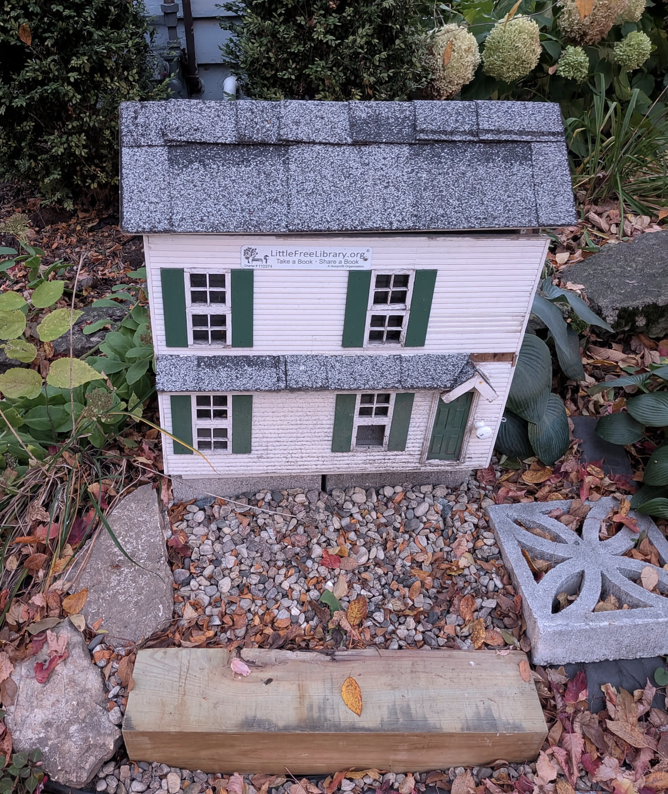

**Edit: A previous version of this post had the colors of the dots inverted**



A quick map for Day 1 of the #30DayMapChallenge. I'm on a mission to collect photos of public book cases in Madison. Madison has an incredible density of these, with 267 mapped in OpenStreetMap. How many of these have photos? Let's see. I downloaded the data from [Overpass Turbo](https://overpass-turbo.eu) with this query:

```
  [out:json][timeout:60];
  {{geocodeArea:Madison, Wisconsin}}->.a;
  node["amenity"="public_bookcase"](area.a);
  out center;
```

You could do this right inside R with the [`osmdata`](https://github.com/ropensci/osmdata/) package, but many public Overpass servers have been hit with AI crawlers and therefore are often unavailable. Instead I used the web instance of Overpass Turbo and downloaded the results as a `geojson` file. Let's make a map!

```{r layout="l-body-outset"}
library(tidyverse)
library(sf)
library(tmap)
library(tigris)
options(tigris_use_cache = TRUE)

madison <- places(state = 55, cb = TRUE) |> 
  filter(NAME == "Madison")

bookcases <- st_read("data/export.geojson")

tmap_mode("plot")
bookcases <- bookcases |> 
  mutate(photo = if_else(is.na(panoramax), "no photo", "photo"))

  tm_basemap(server = "Stadia.StamenTonerLite", api = Sys.getenv("STADIA_API_KEY")) +
tm_shape(madison) +
  tm_polygons(fill_alpha = .2) +
  tm_shape(bookcases) +
  tm_dots(fill = "photo") +
  tm_title("Public book cases in Madison, Wisconsin")
```

Most of them don't have photos and the ones that do are clustered on the near west side. Why? Because that's where I live and have started my photo collection efforts! If you want to contribute to these efforts, in Madison or elsewhere, the [Mapcomplete web app](https://mapcomplete.org/bookcases.html) makes it easy. 